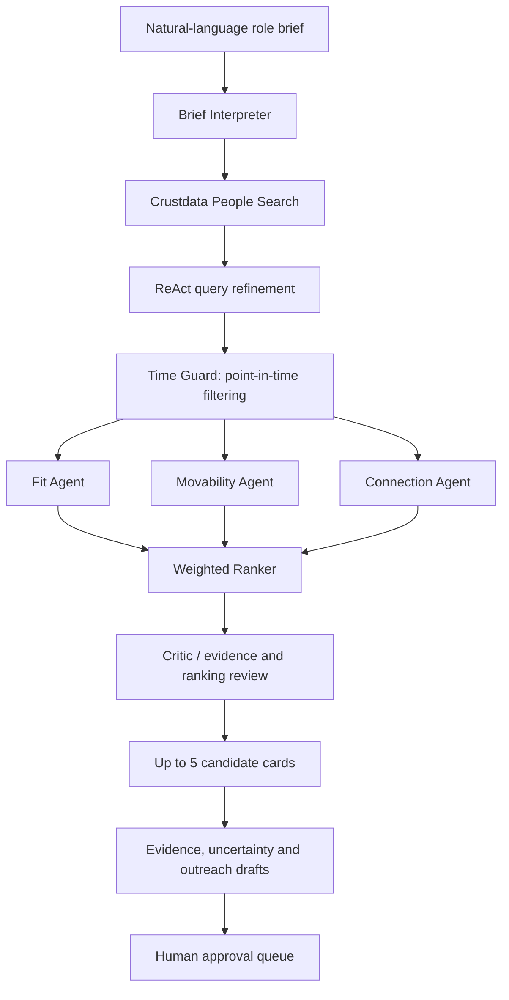

# Time-Travel Recruiter
### Outcome-Grounded, Evidence-Backed Candidate Sourcing

> **Hackathon project | Recruiter-side sourcing agent**
>
> Turn a natural-language role brief into a ranked shortlist of up to five candidates, with evidence-backed explanations and outreach drafts queued for human approval. Evaluate the ranking strategy against historical hiring outcomes while enforcing point-in-time data boundaries.

---

## 1. The problem

Recruiters often search for candidates using static keyword filters and broad profile similarity. These approaches can return people who look relevant on paper but may be poor prospects in practice:

- A candidate may match the role but lack the required depth or seniority.
- A strong-fit candidate may be unlikely to move.
- A candidate may be difficult to reach through the recruiter's existing network.
- Current profile information can accidentally leak into an evaluation of a historical hiring decision.

The result is a shortlist that may be relevant, but is not necessarily actionable or historically defensible.

## 2. Our solution

**Time-Travel Recruiter** is an outcome-grounded sourcing workflow. It combines three complementary signals:

| Signal | What it measures | Question it answers |
|---|---|---|
| **Fit (F)** | Role-to-candidate alignment | Can this person do the job? |
| **Movability (M)** | Evidence that the candidate may be open to a move | Is this person plausibly movable? |
| **Connection (C)** | The strength of the available path to reach the candidate | Can the recruiter establish a credible connection? |

The signals are combined into a configurable score:

\[
S = w_F F + w_M M + w_C C
\]

where the weights determine the relative contribution of Fit, Movability and Connection.

The system returns a ranked shortlist with supporting evidence, uncertainty, and draft outreach. **Outreach is not sent automatically**: it is placed in a human-approval workflow.

## 3. End-to-end workflow



### Workflow stages

1. **Brief interpretation** — converts the recruiter's natural-language request into a structured role brief and search criteria.
2. **Candidate discovery** — queries Crustdata's people-search capability. A ReAct-style loop can refine search queries when the initial candidate pool is insufficient or poorly targeted.
3. **Point-in-time control** — the Time Guard applies the historical cutoff so that evaluation does not use information that would not have been available at the time of the historical opening.
4. **Independent assessment** — Fit, Movability and Connection agents assess candidates along separate dimensions.
5. **Ranking** — the ranker combines the signals using configurable weights.
6. **Critic review** — a Critic checks the shortlist and its supporting evidence before results are presented.
7. **Recruiter handoff** — the system produces up to five candidate cards, explanations, uncertainty information and outreach drafts for human review.

## 4. What makes this different?

### Outcome-grounded evaluation

A sourcing system should be evaluated on more than whether its results sound plausible. This project is designed to test whether adding Movability and Connection to Fit improves retrieval of candidates associated with actual historical hiring outcomes.

### Time-travel / point-in-time evaluation

For a historical opening, the evaluation must respect what was knowable at that point in time. The Time Guard is intended to prevent post-opening information from leaking into candidate assessment.

### Multi-signal ranking

The project compares a simple keyword baseline with progressively richer ranking strategies. This makes it possible to measure the incremental value of each signal rather than assuming that a more complex agent is automatically better.

### Human-in-the-loop outreach

The system drafts outreach but keeps the final decision with the recruiter. This creates a review point before any external communication.

---

## 5. Evaluation methodology

The evaluation framework compares ranking variants to isolate the contribution of each signal.

| Variant | Ranking strategy | Purpose |
|---|---|---|
| **A0** | Keyword baseline | Establish a simple retrieval baseline |
| **A1** | Fit | Measure role-fit ranking |
| **A2** | Fit + Movability | Measure the incremental value of Movability |
| **A3** | Fit + Connection | Measure the incremental value of Connection |
| **A4** | Fit + Movability + Connection | Evaluate the full multi-signal approach |

### Metrics

- **Pool Recall** — whether relevant historical candidates appear anywhere in the retrieved candidate pool.
- **Recall@K** — the fraction of relevant candidates present in the top *K* results.
- **MRR (Mean Reciprocal Rank)** — rewards placing a relevant candidate higher in the ranked list.
- **Confidence intervals** — communicate uncertainty around measured performance rather than relying on a single point estimate.
- **Leakage checks** — test whether the evaluation respects the historical information cutoff.
- **Held-out cases** — assess performance on cases not used to tune the approach.

The intended comparison is whether A4 improves ranking quality over A0–A3, and whether any improvement is consistent across held-out historical cases.

> **Important:** Do not interpret simulated test output as live Crustdata performance or as a completed historical backtest. The current saved evaluation result used `crust=sim` and `llm=mock`. No completed real-hire backtest performance figures are claimed in this README.

---

## 6. Architecture

The implementation is organized around distinct responsibilities:

| Component | Responsibility |
|---|---|
| Crustdata client | Encapsulates candidate-search API access |
| Brief Interpreter | Converts the role brief into structured search intent |
| Search / ReAct loop | Refines candidate-search queries |
| Time Guard | Enforces point-in-time constraints |
| Fit Agent | Assesses role alignment |
| Movability Agent | Assesses evidence of candidate mobility |
| Connection Agent | Assesses the available connection path |
| Ranker | Combines signal scores into an ordered shortlist |
| Critic | Reviews ranking quality and evidence |
| Outreach approval queue | Holds draft outreach for human approval |
| Evaluation modules | Compare ranking variants and run robustness checks |
| CLI | Provides an operational entry point for running the workflow |

The exact module paths and package layout should be read from the repository; this README intentionally avoids guessing filenames that have not been verified.

---

## 7. Setup

### Requirements

- Python environment compatible with the project dependencies.
- A Crustdata API credential for live candidate search.
- Any LLM credentials required by the configured live LLM backend.
- Git, if cloning the repository.

### Get the code

```bash
git clone <REPOSITORY_URL>
cd <REPOSITORY_DIRECTORY>
```

### Create and activate a virtual environment

**Windows PowerShell**
```powershell
python -m venv .venv
.\.venv\Scripts\Activate.ps1
```

**macOS / Linux**
```bash
python -m venv .venv
source .venv/bin/activate
```

Install the dependencies using the dependency file included in the repository. For example, if the repository contains `requirements.txt`:

```bash
pip install -r requirements.txt
```

### Configure credentials

Set the Crustdata API credential and any required LLM credentials using the configuration mechanism expected by the project. **Use the exact variable names documented in the code/configuration; do not commit secrets to Git.**

The repository's configuration files and client implementation are the source of truth for required environment-variable names.

---

## 8. Run and test

Run commands from the repository root with the project's virtual environment activated.

### Test suite

```bash
python -m pytest -q
```

### Simulated robustness evaluation

```bash
python -m eval.robustness --crust-backend sim --llm-backend mock
```

This runs the robustness workflow with simulated Crustdata responses and a mock LLM backend. It is useful for reproducible testing without consuming live API credits.

### Live Crustdata connectivity / credit check

The project also supports constructing a live context with a mock LLM backend:

```python
build_context(
    ...,
    crust_backend="live",
    llm_backend="mock",
)
```

Use the repository's actual CLI or calling module to execute this snippet in the intended application context. This checks the live Crustdata path without requiring the LLM backend to be live.

### Test status recorded during development

- **72/72** non-Time-Guard tests passed in the recorded test run.
- **24/24** simulated robustness tests passed in the recorded run.
- **22** Time Guard tests were identified as requiring the specified Windows Python 3.12.5 environment.

These are development-run results, not a guarantee that every machine or environment will reproduce them. Re-run the commands above on the judging machine.

---

## 9. Demo guide for judges

A useful demonstration follows the same path as a recruiter:

1. Enter a role brief in natural language.
2. Show how the brief is interpreted into structured search intent.
3. Run candidate discovery through the configured Crustdata backend.
4. Explain how the Time Guard applies the historical cutoff.
5. Inspect the Fit, Movability and Connection assessments.
6. Show how the weighted ranker orders candidates and how the Critic reviews the result.
7. Open the top candidate cards and inspect the evidence and uncertainty behind each recommendation.
8. Review an outreach draft in the approval queue. Emphasize that a human must approve it before it is sent.
9. If demonstrating evaluation, distinguish simulated robustness tests from a real historical backtest.

**Suggested judge takeaway:** this is not simply a profile-matching chatbot. It is a recruiter-side sourcing and decision-support workflow whose ranking hypothesis can be tested against historical hiring outcomes, with explicit point-in-time controls and human approval before outreach.

---

## 10. Responsible use and limitations

- Candidate scores are decision-support signals, not objective measures of a person's worth or guaranteed job performance.
- Profile data can be incomplete, stale or incorrect. Review evidence and uncertainty before acting.
- Movability and Connection are inferences from available evidence; they should not be treated as certainty about a person's intentions or relationships.
- Historical evaluation is only credible when the candidate pool, labels and point-in-time cutoff are defined consistently and leakage is controlled.
- Simulated backends validate software behavior; they do not establish live search quality or real-world hiring lift.
- Outreach drafts require human review and approval. The system should not be represented as autonomously contacting candidates.

---

## 11. Project status and reproducibility

The codebase includes the Crustdata client/API integration, agent workflow, Time Guard, ranker, Critic, outreach approval queue, evaluation variants and robustness tests.

The recorded simulated results are useful for demonstrating software execution and test coverage. A completed real-hire historical backtest, with reported metrics and confidence intervals, should be presented separately once run on a verified dataset. Do not report simulated metrics as historical hiring performance.

For judging, use the repository's current dependency/configuration files and the commands in **Run and test**. If a command or configuration detail differs in the checked-out version, the implementation is authoritative.

---

## 12. Team and credits

- **Project:** Time-Travel Recruiter — Outcome-Grounded Sourcing Agent
- **Candidate data/search provider:** Crustdata
- **Built for:** Hackathon evaluation

Add team member names, repository URL, demo URL and any third-party model/API acknowledgements here.

---

*This README describes the implementation and evaluation status available at the time of writing. Update the setup commands, configuration names, repository structure, and measured results if the codebase changes before submission.*
